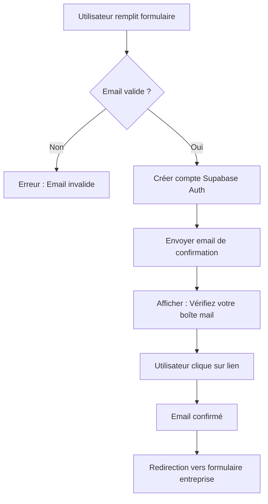

# 🏢 Plan d'Architecture : Système de Validation d'Entreprise IMOTION MANUS IA 2.0

## 📋 Vue d'ensemble

Ce document décrit l'architecture complète du système de validation d'entreprise pour garantir :
- ✅ Authentification robuste avec vérification email **obligatoire**
- ✅ Identification entreprise complète (SIRET/SIREN + données légales)
- ✅ Validation de légitimité (la personne représente bien l'entreprise)
- ✅ Anti-abus (pas de faux utilisateurs, données vérifiables)
- ✅ Qualité des audits (données d'entrée sérieuses pour les agents IA)

---

## 🎯 Objectifs Stratégiques

### 1. Sécurité & Authentification
- **Email obligatoire** : Vérification par lien de confirmation
- **Pas d'accès sans validation** : Aucun audit possible avant confirmation email
- **Session sécurisée** : JWT vérifié sur toutes les Edge Functions

### 2. Identification Entreprise
- **SIRET/SIREN obligatoire** : Validation via API gouvernementale (INSEE)
- **Informations légales** : Raison sociale, adresse, forme juridique
- **Rôle utilisateur** : Dirigeant, Responsable Marketing, etc.
- **Contact professionnel** : Email + téléphone entreprise

### 3. Validation de Légitimité
- **Email professionnel** : Préférer email @domaine-entreprise.com
- **Vérification croisée** : Email pro doit correspondre au domaine du site audité
- **Preuve de représentation** : Document officiel (Kbis, délégation de pouvoir)
- **Double validation** : Email + téléphone professionnel

### 4. Anti-Abus
- **Rate limiting** : Max 3 audits gratuits par entreprise
- **Détection doublons** : SIRET déjà utilisé = compte existant
- **Modération manuelle** : Validation admin pour premiers audits
- **Scoring de confiance** : Algorithme de détection de faux comptes

---

## 🗄️ Architecture Base de Données

### Modifications à apporter

#### 1. Table `profiles` (existante - à modifier)

**Colonnes à ajouter** :
```sql
ALTER TABLE profiles ADD COLUMN IF NOT EXISTS company_siret VARCHAR(14);
ALTER TABLE profiles ADD COLUMN IF NOT EXISTS company_siren VARCHAR(9);
ALTER TABLE profiles ADD COLUMN IF NOT EXISTS company_legal_name TEXT;
ALTER TABLE profiles ADD COLUMN IF NOT EXISTS company_address TEXT;
ALTER TABLE profiles ADD COLUMN IF NOT EXISTS company_legal_form VARCHAR(100);
ALTER TABLE profiles ADD COLUMN IF NOT EXISTS user_role VARCHAR(100);
ALTER TABLE profiles ADD COLUMN IF NOT EXISTS user_first_name VARCHAR(100);
ALTER TABLE profiles ADD COLUMN IF NOT EXISTS user_last_name VARCHAR(100);
ALTER TABLE profiles ADD COLUMN IF NOT EXISTS professional_email VARCHAR(255);
ALTER TABLE profiles ADD COLUMN IF NOT EXISTS professional_phone VARCHAR(20);
ALTER TABLE profiles ADD COLUMN IF NOT EXISTS email_verified_at TIMESTAMPTZ;
ALTER TABLE profiles ADD COLUMN IF NOT EXISTS company_verified_at TIMESTAMPTZ;
ALTER TABLE profiles ADD COLUMN IF NOT EXISTS legitimacy_verified_at TIMESTAMPTZ;
ALTER TABLE profiles ADD COLUMN IF NOT EXISTS verification_document_url TEXT;
ALTER TABLE profiles ADD COLUMN IF NOT EXISTS trust_score INTEGER DEFAULT 0;
ALTER TABLE profiles ADD COLUMN IF NOT EXISTS max_free_audits INTEGER DEFAULT 3;
ALTER TABLE profiles ADD COLUMN IF NOT EXISTS free_audits_used INTEGER DEFAULT 0;

-- Index pour recherche rapide par SIRET
CREATE INDEX IF NOT EXISTS idx_profiles_siret ON profiles(company_siret);
CREATE INDEX IF NOT EXISTS idx_profiles_siren ON profiles(company_siren);
```

**Contraintes** :
```sql
-- SIRET doit être unique (une entreprise = un compte)
ALTER TABLE profiles ADD CONSTRAINT unique_siret UNIQUE (company_siret);

-- SIRET doit être valide (14 chiffres)
ALTER TABLE profiles ADD CONSTRAINT valid_siret 
  CHECK (company_siret ~ '^[0-9]{14}$');

-- SIREN doit être valide (9 chiffres)
ALTER TABLE profiles ADD CONSTRAINT valid_siren 
  CHECK (company_siren ~ '^[0-9]{9}$');

-- Trust score entre 0 et 100
ALTER TABLE profiles ADD CONSTRAINT valid_trust_score 
  CHECK (trust_score >= 0 AND trust_score <= 100);
```

#### 2. Table `company_verification_logs` (nouvelle)

**Objectif** : Tracer toutes les tentatives de vérification d'entreprise

```sql
CREATE TABLE IF NOT EXISTS company_verification_logs (
  id UUID PRIMARY KEY DEFAULT gen_random_uuid(),
  user_id UUID REFERENCES auth.users(id) ON DELETE CASCADE,
  siret VARCHAR(14),
  verification_type VARCHAR(50), -- 'insee_api', 'email_domain', 'manual_document'
  verification_status VARCHAR(20), -- 'pending', 'success', 'failed', 'rejected'
  verification_data JSONB, -- Réponse API INSEE ou autres données
  verified_by UUID REFERENCES auth.users(id), -- Admin qui a validé manuellement
  notes TEXT,
  created_at TIMESTAMPTZ DEFAULT NOW(),
  updated_at TIMESTAMPTZ DEFAULT NOW()
);

-- Index pour recherche par utilisateur
CREATE INDEX IF NOT EXISTS idx_verification_logs_user ON company_verification_logs(user_id);
CREATE INDEX IF NOT EXISTS idx_verification_logs_siret ON company_verification_logs(siret);
CREATE INDEX IF NOT EXISTS idx_verification_logs_status ON company_verification_logs(verification_status);
```

#### 3. Table `audit_access_control` (nouvelle)

**Objectif** : Contrôler l'accès aux audits et détecter les abus

```sql
CREATE TABLE IF NOT EXISTS audit_access_control (
  id UUID PRIMARY KEY DEFAULT gen_random_uuid(),
  user_id UUID REFERENCES auth.users(id) ON DELETE CASCADE,
  audit_id UUID REFERENCES pre_audits(id) ON DELETE CASCADE,
  access_granted BOOLEAN DEFAULT FALSE,
  access_reason VARCHAR(100), -- 'free_trial', 'paid', 'admin_override'
  ip_address INET,
  user_agent TEXT,
  created_at TIMESTAMPTZ DEFAULT NOW()
);

-- Index pour détection d'abus
CREATE INDEX IF NOT EXISTS idx_access_control_user ON audit_access_control(user_id);
CREATE INDEX IF NOT EXISTS idx_access_control_ip ON audit_access_control(ip_address);
CREATE INDEX IF NOT EXISTS idx_access_control_created ON audit_access_control(created_at);
```

#### 4. Politiques RLS

```sql
-- Seul l'utilisateur peut voir son profil complet
ALTER TABLE profiles ENABLE ROW LEVEL SECURITY;

CREATE POLICY "Users can view own profile"
  ON profiles FOR SELECT
  USING (auth.uid() = id);

CREATE POLICY "Users can update own profile"
  ON profiles FOR UPDATE
  USING (auth.uid() = id);

-- Logs de vérification : lecture seule pour l'utilisateur
ALTER TABLE company_verification_logs ENABLE ROW LEVEL SECURITY;

CREATE POLICY "Users can view own verification logs"
  ON company_verification_logs FOR SELECT
  USING (auth.uid() = user_id);

-- Admins peuvent tout voir
CREATE POLICY "Admins can view all verification logs"
  ON company_verification_logs FOR SELECT
  USING (
    EXISTS (
      SELECT 1 FROM profiles 
      WHERE id = auth.uid() AND role = 'admin'
    )
  );

-- Contrôle d'accès : lecture seule pour l'utilisateur
ALTER TABLE audit_access_control ENABLE ROW LEVEL SECURITY;

CREATE POLICY "Users can view own access logs"
  ON audit_access_control FOR SELECT
  USING (auth.uid() = user_id);
```

---

## 🔐 Flux d'Authentification & Validation

### Phase 1 : Inscription avec Email Obligatoire



**Configuration Supabase Auth** :
```toml
# supabase/config.toml
[auth.email]
enable_signup = true
enable_confirmations = true  # ✅ OBLIGATOIRE
double_confirm_changes = true
```

**Message après inscription** :
```
✅ Inscription réussie !

Un email de confirmation a été envoyé à votre adresse.
Veuillez cliquer sur le lien pour activer votre compte.

⏱️ Le lien expire dans 24 heures.
```

---

### Phase 2 : Formulaire d'Identification Entreprise

**Déclenchement** : Après confirmation email, l'utilisateur est redirigé vers `/onboarding/company`

**Champs obligatoires** :

1. **Informations Entreprise** :
   - SIRET (14 chiffres) ou SIREN (9 chiffres)
   - Raison sociale (pré-remplie via API INSEE)
   - Adresse du siège (pré-remplie via API INSEE)
   - Forme juridique (pré-remplie via API INSEE)
   - Site web de l'entreprise

2. **Informations Utilisateur** :
   - Prénom
   - Nom
   - Fonction dans l'entreprise (liste déroulante)
     - Dirigeant / Gérant
     - Directeur Marketing
     - Responsable Communication
     - Responsable Commercial
     - Consultant externe
     - Autre (à préciser)
   - Email professionnel (optionnel mais recommandé)
   - Téléphone professionnel

3. **Validation de Légitimité** :
   - Case à cocher : "Je certifie être habilité à représenter cette entreprise"
   - Upload document justificatif (optionnel) :
     - Extrait Kbis (< 3 mois)
     - Délégation de pouvoir
     - Carte de visite professionnelle

**Validation automatique SIRET/SIREN** :

```typescript
// Edge Function: validate-company-siret
async function validateSIRET(siret: string) {
  // 1. Vérifier format (14 chiffres)
  if (!/^[0-9]{14}$/.test(siret)) {
    return { valid: false, error: 'Format SIRET invalide' };
  }

  // 2. Appeler API INSEE (données publiques)
  const response = await fetch(
    `https://api.insee.fr/entreprises/sirene/V3/siret/${siret}`,
    {
      headers: {
        'Authorization': `Bearer ${INSEE_API_TOKEN}`,
        'Accept': 'application/json'
      }
    }
  );

  if (!response.ok) {
    return { valid: false, error: 'SIRET introuvable dans la base INSEE' };
  }

  const data = await response.json();
  
  // 3. Vérifier que l'entreprise est active
  if (data.etablissement.etatAdministratifEtablissement !== 'A') {
    return { valid: false, error: 'Entreprise non active' };
  }

  // 4. Retourner les données légales
  return {
    valid: true,
    data: {
      siret: data.etablissement.siret,
      siren: data.etablissement.siren,
      legalName: data.etablissement.uniteLegale.denominationUniteLegale,
      address: `${data.etablissement.adresseEtablissement.numeroVoieEtablissement} ${data.etablissement.adresseEtablissement.typeVoieEtablissement} ${data.etablissement.adresseEtablissement.libelleVoieEtablissement}, ${data.etablissement.adresseEtablissement.codePostalEtablissement} ${data.etablissement.adresseEtablissement.libelleCommuneEtablissement}`,
      legalForm: data.etablissement.uniteLegale.categorieJuridiqueUniteLegale,
      creationDate: data.etablissement.dateCreationEtablissement
    }
  };
}
```

**API INSEE** :
- Documentation : https://api.insee.fr/catalogue/
- Inscription gratuite : https://api.insee.fr/catalogue/site/themes/wso2/subthemes/insee/pages/sign-up.jag
- Rate limit : 30 requêtes/minute (largement suffisant)

---

### Phase 3 : Validation de Légitimité

**Algorithme de Trust Score** :

```typescript
function calculateTrustScore(user: UserProfile): number {
  let score = 0;

  // 1. Email professionnel correspondant au domaine du site (40 points)
  if (user.professional_email && user.company_website) {
    const emailDomain = user.professional_email.split('@')[1];
    const websiteDomain = new URL(user.company_website).hostname.replace('www.', '');
    if (emailDomain === websiteDomain) {
      score += 40;
    }
  }

  // 2. SIRET validé via API INSEE (30 points)
  if (user.company_verified_at) {
    score += 30;
  }

  // 3. Document justificatif uploadé (20 points)
  if (user.verification_document_url) {
    score += 20;
  }

  // 4. Téléphone professionnel renseigné (10 points)
  if (user.professional_phone) {
    score += 10;
  }

  return score;
}
```

**Niveaux de confiance** :
- **0-30** : 🔴 Faible confiance → Modération manuelle obligatoire
- **31-60** : 🟠 Confiance moyenne → 1 audit gratuit, puis modération
- **61-100** : 🟢 Haute confiance → 3 audits gratuits

---

### Phase 4 : Contrôle d'Accès aux Audits

**Vérifications avant de lancer un audit** :

```typescript
// Edge Function: check-audit-access
async function checkAuditAccess(userId: string, websiteUrl: string) {
  // 1. Vérifier que l'email est confirmé
  const { data: user } = await supabase.auth.admin.getUserById(userId);
  if (!user.email_confirmed_at) {
    return { 
      allowed: false, 
      reason: 'email_not_confirmed',
      message: 'Veuillez confirmer votre email avant de lancer un audit.'
    };
  }

  // 2. Vérifier que les infos entreprise sont remplies
  const { data: profile } = await supabase
    .from('profiles')
    .select('*')
    .eq('id', userId)
    .single();

  if (!profile.company_siret) {
    return {
      allowed: false,
      reason: 'company_info_missing',
      message: 'Veuillez compléter vos informations entreprise.'
    };
  }

  // 3. Vérifier le nombre d'audits gratuits restants
  if (profile.free_audits_used >= profile.max_free_audits) {
    return {
      allowed: false,
      reason: 'free_audits_exhausted',
      message: 'Vous avez utilisé vos 3 audits gratuits. Passez à la version Premium.'
    };
  }

  // 4. Vérifier la correspondance domaine email/site (si email pro renseigné)
  if (profile.professional_email) {
    const emailDomain = profile.professional_email.split('@')[1];
    const websiteDomain = new URL(websiteUrl).hostname.replace('www.', '');
    
    if (emailDomain !== websiteDomain) {
      // Pas bloquant, mais baisse le trust score
      await supabase
        .from('profiles')
        .update({ trust_score: Math.max(0, profile.trust_score - 10) })
        .eq('id', userId);
      
      // Log suspect
      await supabase
        .from('company_verification_logs')
        .insert({
          user_id: userId,
          siret: profile.company_siret,
          verification_type: 'email_domain_mismatch',
          verification_status: 'warning',
          verification_data: {
            professional_email: profile.professional_email,
            website_url: websiteUrl,
            message: 'Email professionnel ne correspond pas au domaine du site audité'
          }
        });
    }
  }

  // 5. Vérifier le trust score
  if (profile.trust_score < 30 && profile.free_audits_used === 0) {
    return {
      allowed: false,
      reason: 'low_trust_score',
      message: 'Votre compte nécessite une validation manuelle. Un administrateur vous contactera sous 24h.'
    };
  }

  // 6. Rate limiting par IP
  const { count } = await supabase
    .from('audit_access_control')
    .select('*', { count: 'exact', head: true })
    .eq('ip_address', request.headers.get('x-forwarded-for'))
    .gte('created_at', new Date(Date.now() - 3600000).toISOString()); // Dernière heure

  if (count > 10) {
    return {
      allowed: false,
      reason: 'rate_limit_exceeded',
      message: 'Trop de requêtes. Veuillez réessayer dans 1 heure.'
    };
  }

  // ✅ Accès autorisé
  return {
    allowed: true,
    reason: 'free_trial',
    remaining_audits: profile.max_free_audits - profile.free_audits_used
  };
}
```

---

## 🎨 Interface Utilisateur

### 1. Page d'Inscription (`/auth`)

**Modifications à apporter** :
- ✅ Garder le formulaire actuel (email + mot de passe)
- ✅ Ajouter message clair : "Un email de confirmation sera envoyé"
- ✅ Après inscription, afficher modal de confirmation :

```tsx
<Modal>
  <h2>✅ Inscription réussie !</h2>
  <p>Un email de confirmation a été envoyé à <strong>{email}</strong></p>
  <p>Veuillez cliquer sur le lien pour activer votre compte.</p>
  <p className="text-sm text-gray-500">
    ⏱️ Le lien expire dans 24 heures.<br/>
    📧 Pensez à vérifier vos spams.
  </p>
  <Button onClick={() => navigate('/auth')}>OK</Button>
</Modal>
```

### 2. Page Onboarding Entreprise (`/onboarding/company`)

**Nouvelle page à créer** :

```tsx
// src/pages/OnboardingCompany.tsx
export default function OnboardingCompany() {
  const [siret, setSiret] = useState('');
  const [companyData, setCompanyData] = useState(null);
  const [loading, setLoading] = useState(false);

  const validateSIRET = async () => {
    setLoading(true);
    const { data, error } = await supabase.functions.invoke('validate-company-siret', {
      body: { siret }
    });
    
    if (error) {
      toast.error(error.message);
    } else {
      setCompanyData(data);
      toast.success('SIRET validé ! Vérifiez les informations ci-dessous.');
    }
    setLoading(false);
  };

  return (
    <div className="max-w-2xl mx-auto p-6">
      <h1>Identification de votre entreprise</h1>
      
      {/* Étape 1 : SIRET */}
      <div className="mb-6">
        <label>SIRET de votre entreprise *</label>
        <input 
          type="text" 
          value={siret}
          onChange={(e) => setSiret(e.target.value)}
          placeholder="14 chiffres"
          maxLength={14}
        />
        <Button onClick={validateSIRET} disabled={loading}>
          {loading ? 'Validation...' : 'Valider le SIRET'}
        </Button>
      </div>

      {/* Étape 2 : Infos pré-remplies */}
      {companyData && (
        <>
          <div className="mb-4">
            <label>Raison sociale</label>
            <input type="text" value={companyData.legalName} disabled />
          </div>
          <div className="mb-4">
            <label>Adresse du siège</label>
            <input type="text" value={companyData.address} disabled />
          </div>
          <div className="mb-4">
            <label>Forme juridique</label>
            <input type="text" value={companyData.legalForm} disabled />
          </div>
        </>
      )}

      {/* Étape 3 : Infos utilisateur */}
      <div className="mb-4">
        <label>Prénom *</label>
        <input type="text" />
      </div>
      <div className="mb-4">
        <label>Nom *</label>
        <input type="text" />
      </div>
      <div className="mb-4">
        <label>Fonction dans l'entreprise *</label>
        <select>
          <option>Dirigeant / Gérant</option>
          <option>Directeur Marketing</option>
          <option>Responsable Communication</option>
          <option>Responsable Commercial</option>
          <option>Consultant externe</option>
          <option>Autre</option>
        </select>
      </div>

      {/* Étape 4 : Email pro (recommandé) */}
      <div className="mb-4">
        <label>Email professionnel (recommandé)</label>
        <input type="email" placeholder="prenom.nom@entreprise.com" />
        <p className="text-sm text-gray-500">
          💡 Utilisez votre email professionnel pour augmenter votre score de confiance
        </p>
      </div>

      {/* Étape 5 : Document justificatif */}
      <div className="mb-4">
        <label>Document justificatif (optionnel)</label>
        <input type="file" accept=".pdf,.jpg,.png" />
        <p className="text-sm text-gray-500">
          Kbis, délégation de pouvoir, carte de visite...
        </p>
      </div>

      {/* Certification */}
      <div className="mb-6">
        <label className="flex items-center">
          <input type="checkbox" required />
          <span className="ml-2">
            Je certifie être habilité à représenter cette entreprise
          </span>
        </label>
      </div>

      <Button type="submit">Valider et accéder à mon compte</Button>
    </div>
  );
}
```

### 3. Protection des Routes

**Middleware de vérification** :

```tsx
// src/components/ProtectedRoute.tsx
export function ProtectedRoute({ children, requireCompanyInfo = false }) {
  const { session } = useAuth();
  const [profile, setProfile] = useState(null);
  const navigate = useNavigate();

  useEffect(() => {
    if (!session) {
      navigate('/auth');
      return;
    }

    // Vérifier email confirmé
    if (!session.user.email_confirmed_at) {
      toast.error('Veuillez confirmer votre email avant de continuer.');
      navigate('/auth/confirm-email');
      return;
    }

    // Vérifier infos entreprise si requis
    if (requireCompanyInfo) {
      supabase
        .from('profiles')
        .select('company_siret')
        .eq('id', session.user.id)
        .single()
        .then(({ data }) => {
          if (!data?.company_siret) {
            toast.info('Veuillez compléter vos informations entreprise.');
            navigate('/onboarding/company');
          } else {
            setProfile(data);
          }
        });
    }
  }, [session]);

  if (!session || (requireCompanyInfo && !profile)) {
    return <div>Chargement...</div>;
  }

  return children;
}
```

**Utilisation** :

```tsx
// src/App.tsx
<Route path="/client/new-project" element={
  <ProtectedRoute requireCompanyInfo={true}>
    <NewProjectPage />
  </ProtectedRoute>
} />
```

---

## 🔧 Edge Functions à Créer/Modifier

### 1. `validate-company-siret` (nouvelle)

**Fichier** : `supabase/functions/validate-company-siret/index.ts`

```typescript
import { serve } from 'https://deno.land/std@0.168.0/http/server.ts';
import { createClient } from 'https://esm.sh/@supabase/supabase-js@2';

serve(async (req) => {
  try {
    const { siret } = await req.json();

    // Validation format
    if (!/^[0-9]{14}$/.test(siret)) {
      return new Response(
        JSON.stringify({ error: 'Format SIRET invalide (14 chiffres requis)' }),
        { status: 400, headers: { 'Content-Type': 'application/json' } }
      );
    }

    // Appel API INSEE
    const response = await fetch(
      `https://api.insee.fr/entreprises/sirene/V3/siret/${siret}`,
      {
        headers: {
          'Authorization': `Bearer ${Deno.env.get('INSEE_API_TOKEN')}`,
          'Accept': 'application/json'
        }
      }
    );

    if (!response.ok) {
      return new Response(
        JSON.stringify({ error: 'SIRET introuvable dans la base INSEE' }),
        { status: 404, headers: { 'Content-Type': 'application/json' } }
      );
    }

    const data = await response.json();
    const etablissement = data.etablissement;

    // Vérifier entreprise active
    if (etablissement.etatAdministratifEtablissement !== 'A') {
      return new Response(
        JSON.stringify({ error: 'Cette entreprise n\'est plus active' }),
        { status: 400, headers: { 'Content-Type': 'application/json' } }
      );
    }

    // Retourner données structurées
    return new Response(
      JSON.stringify({
        valid: true,
        siret: etablissement.siret,
        siren: etablissement.siren,
        legalName: etablissement.uniteLegale.denominationUniteLegale,
        address: `${etablissement.adresseEtablissement.numeroVoieEtablissement} ${etablissement.adresseEtablissement.typeVoieEtablissement} ${etablissement.adresseEtablissement.libelleVoieEtablissement}, ${etablissement.adresseEtablissement.codePostalEtablissement} ${etablissement.adresseEtablissement.libelleCommuneEtablissement}`,
        legalForm: etablissement.uniteLegale.categorieJuridiqueUniteLegale,
        creationDate: etablissement.dateCreationEtablissement
      }),
      { status: 200, headers: { 'Content-Type': 'application/json' } }
    );

  } catch (error) {
    return new Response(
      JSON.stringify({ error: error.message }),
      { status: 500, headers: { 'Content-Type': 'application/json' } }
    );
  }
});
```

### 2. `check-audit-access` (nouvelle)

**Fichier** : `supabase/functions/check-audit-access/index.ts`

```typescript
import { serve } from 'https://deno.land/std@0.168.0/http/server.ts';
import { createClient } from 'https://esm.sh/@supabase/supabase-js@2';

serve(async (req) => {
  try {
    const supabaseClient = createClient(
      Deno.env.get('SUPABASE_URL') ?? '',
      Deno.env.get('SUPABASE_ANON_KEY') ?? '',
      {
        global: {
          headers: { Authorization: req.headers.get('Authorization')! },
        },
      }
    );

    // Récupérer l'utilisateur authentifié
    const { data: { user }, error: authError } = await supabaseClient.auth.getUser();
    if (authError || !user) {
      return new Response(
        JSON.stringify({ allowed: false, reason: 'not_authenticated' }),
        { status: 401, headers: { 'Content-Type': 'application/json' } }
      );
    }

    const { websiteUrl } = await req.json();

    // 1. Vérifier email confirmé
    if (!user.email_confirmed_at) {
      return new Response(
        JSON.stringify({
          allowed: false,
          reason: 'email_not_confirmed',
          message: 'Veuillez confirmer votre email avant de lancer un audit.'
        }),
        { status: 403, headers: { 'Content-Type': 'application/json' } }
      );
    }

    // 2. Récupérer le profil
    const { data: profile, error: profileError } = await supabaseClient
      .from('profiles')
      .select('*')
      .eq('id', user.id)
      .single();

    if (profileError || !profile) {
      return new Response(
        JSON.stringify({ allowed: false, reason: 'profile_not_found' }),
        { status: 404, headers: { 'Content-Type': 'application/json' } }
      );
    }

    // 3. Vérifier infos entreprise
    if (!profile.company_siret) {
      return new Response(
        JSON.stringify({
          allowed: false,
          reason: 'company_info_missing',
          message: 'Veuillez compléter vos informations entreprise.'
        }),
        { status: 403, headers: { 'Content-Type': 'application/json' } }
      );
    }

    // 4. Vérifier audits gratuits restants
    if (profile.free_audits_used >= profile.max_free_audits) {
      return new Response(
        JSON.stringify({
          allowed: false,
          reason: 'free_audits_exhausted',
          message: 'Vous avez utilisé vos 3 audits gratuits. Passez à la version Premium.'
        }),
        { status: 403, headers: { 'Content-Type': 'application/json' } }
      );
    }

    // 5. Vérifier trust score
    if (profile.trust_score < 30 && profile.free_audits_used === 0) {
      return new Response(
        JSON.stringify({
          allowed: false,
          reason: 'low_trust_score',
          message: 'Votre compte nécessite une validation manuelle. Un administrateur vous contactera sous 24h.'
        }),
        { status: 403, headers: { 'Content-Type': 'application/json' } }
      );
    }

    // 6. Rate limiting par IP
    const ipAddress = req.headers.get('x-forwarded-for') || req.headers.get('x-real-ip');
    const oneHourAgo = new Date(Date.now() - 3600000).toISOString();

    const { count } = await supabaseClient
      .from('audit_access_control')
      .select('*', { count: 'exact', head: true })
      .eq('ip_address', ipAddress)
      .gte('created_at', oneHourAgo);

    if (count && count > 10) {
      return new Response(
        JSON.stringify({
          allowed: false,
          reason: 'rate_limit_exceeded',
          message: 'Trop de requêtes. Veuillez réessayer dans 1 heure.'
        }),
        { status: 429, headers: { 'Content-Type': 'application/json' } }
      );
    }

    // ✅ Accès autorisé
    // Logger l'accès
    await supabaseClient
      .from('audit_access_control')
      .insert({
        user_id: user.id,
        access_granted: true,
        access_reason: 'free_trial',
        ip_address: ipAddress,
        user_agent: req.headers.get('user-agent')
      });

    return new Response(
      JSON.stringify({
        allowed: true,
        reason: 'free_trial',
        remaining_audits: profile.max_free_audits - profile.free_audits_used,
        trust_score: profile.trust_score
      }),
      { status: 200, headers: { 'Content-Type': 'application/json' } }
    );

  } catch (error) {
    return new Response(
      JSON.stringify({ error: error.message }),
      { status: 500, headers: { 'Content-Type': 'application/json' } }
    );
  }
});
```

### 3. Modifier `orchestrate-multi-agent`

**Ajouter au début de la fonction** :

```typescript
// Vérifier l'accès avant de lancer l'orchestration
const { data: accessCheck, error: accessError } = await supabase.functions.invoke('check-audit-access', {
  body: { websiteUrl: url }
});

if (accessError || !accessCheck.allowed) {
  return new Response(
    JSON.stringify({ 
      error: accessCheck.message || 'Accès refusé',
      reason: accessCheck.reason 
    }),
    { status: 403, headers: { 'Content-Type': 'application/json' } }
  );
}

// Incrémenter le compteur d'audits gratuits
await supabase
  .from('profiles')
  .update({ 
    free_audits_used: profile.free_audits_used + 1 
  })
  .eq('id', user.id);
```

---

## 📧 Configuration Email Supabase

### Activer la confirmation email

**Dans Supabase Dashboard** :
1. Aller dans **Authentication** → **Email Templates**
2. Activer **"Confirm signup"**
3. Personnaliser le template :

```html
<h2>Bienvenue sur IMOTION MANUS IA !</h2>

<p>Merci de vous être inscrit. Pour activer votre compte, veuillez cliquer sur le lien ci-dessous :</p>

<p><a href="{{ .ConfirmationURL }}">Confirmer mon email</a></p>

<p>Ce lien expire dans 24 heures.</p>

<p>Si vous n'êtes pas à l'origine de cette inscription, vous pouvez ignorer cet email.</p>

<p>L'équipe IMOTION</p>
```

### Configurer Resend (SMTP)

**Dans Supabase Dashboard** :
1. Aller dans **Project Settings** → **Auth**
2. Scroller jusqu'à **SMTP Settings**
3. Remplir :
   - **Host** : `smtp.resend.com`
   - **Port** : `465`
   - **User** : `resend`
   - **Password** : Votre clé API Resend
   - **Sender email** : `noreply@imotion.fr`
   - **Sender name** : `IMOTION MANUS IA`

---

## 🚀 Plan de Déploiement

### Étape 1 : Modifications Base de Données

**Fichier SQL à créer** : `DEPLOYMENT_SQL_VALIDATION_ENTREPRISE.sql`

```sql
-- 1. Ajouter colonnes à profiles
ALTER TABLE profiles ADD COLUMN IF NOT EXISTS company_siret VARCHAR(14);
ALTER TABLE profiles ADD COLUMN IF NOT EXISTS company_siren VARCHAR(9);
ALTER TABLE profiles ADD COLUMN IF NOT EXISTS company_legal_name TEXT;
ALTER TABLE profiles ADD COLUMN IF NOT EXISTS company_address TEXT;
ALTER TABLE profiles ADD COLUMN IF NOT EXISTS company_legal_form VARCHAR(100);
ALTER TABLE profiles ADD COLUMN IF NOT EXISTS user_role VARCHAR(100);
ALTER TABLE profiles ADD COLUMN IF NOT EXISTS user_first_name VARCHAR(100);
ALTER TABLE profiles ADD COLUMN IF NOT EXISTS user_last_name VARCHAR(100);
ALTER TABLE profiles ADD COLUMN IF NOT EXISTS professional_email VARCHAR(255);
ALTER TABLE profiles ADD COLUMN IF NOT EXISTS professional_phone VARCHAR(20);
ALTER TABLE profiles ADD COLUMN IF NOT EXISTS email_verified_at TIMESTAMPTZ;
ALTER TABLE profiles ADD COLUMN IF NOT EXISTS company_verified_at TIMESTAMPTZ;
ALTER TABLE profiles ADD COLUMN IF NOT EXISTS legitimacy_verified_at TIMESTAMPTZ;
ALTER TABLE profiles ADD COLUMN IF NOT EXISTS verification_document_url TEXT;
ALTER TABLE profiles ADD COLUMN IF NOT EXISTS trust_score INTEGER DEFAULT 0;
ALTER TABLE profiles ADD COLUMN IF NOT EXISTS max_free_audits INTEGER DEFAULT 3;
ALTER TABLE profiles ADD COLUMN IF NOT EXISTS free_audits_used INTEGER DEFAULT 0;

-- 2. Créer index
CREATE INDEX IF NOT EXISTS idx_profiles_siret ON profiles(company_siret);
CREATE INDEX IF NOT EXISTS idx_profiles_siren ON profiles(company_siren);

-- 3. Ajouter contraintes
ALTER TABLE profiles ADD CONSTRAINT unique_siret UNIQUE (company_siret);
ALTER TABLE profiles ADD CONSTRAINT valid_siret CHECK (company_siret ~ '^[0-9]{14}$');
ALTER TABLE profiles ADD CONSTRAINT valid_siren CHECK (company_siren ~ '^[0-9]{9}$');
ALTER TABLE profiles ADD CONSTRAINT valid_trust_score CHECK (trust_score >= 0 AND trust_score <= 100);

-- 4. Créer table company_verification_logs
CREATE TABLE IF NOT EXISTS company_verification_logs (
  id UUID PRIMARY KEY DEFAULT gen_random_uuid(),
  user_id UUID REFERENCES auth.users(id) ON DELETE CASCADE,
  siret VARCHAR(14),
  verification_type VARCHAR(50),
  verification_status VARCHAR(20),
  verification_data JSONB,
  verified_by UUID REFERENCES auth.users(id),
  notes TEXT,
  created_at TIMESTAMPTZ DEFAULT NOW(),
  updated_at TIMESTAMPTZ DEFAULT NOW()
);

CREATE INDEX IF NOT EXISTS idx_verification_logs_user ON company_verification_logs(user_id);
CREATE INDEX IF NOT EXISTS idx_verification_logs_siret ON company_verification_logs(siret);
CREATE INDEX IF NOT EXISTS idx_verification_logs_status ON company_verification_logs(verification_status);

-- 5. Créer table audit_access_control
CREATE TABLE IF NOT EXISTS audit_access_control (
  id UUID PRIMARY KEY DEFAULT gen_random_uuid(),
  user_id UUID REFERENCES auth.users(id) ON DELETE CASCADE,
  audit_id UUID REFERENCES pre_audits(id) ON DELETE CASCADE,
  access_granted BOOLEAN DEFAULT FALSE,
  access_reason VARCHAR(100),
  ip_address INET,
  user_agent TEXT,
  created_at TIMESTAMPTZ DEFAULT NOW()
);

CREATE INDEX IF NOT EXISTS idx_access_control_user ON audit_access_control(user_id);
CREATE INDEX IF NOT EXISTS idx_access_control_ip ON audit_access_control(ip_address);
CREATE INDEX IF NOT EXISTS idx_access_control_created ON audit_access_control(created_at);

-- 6. Activer RLS
ALTER TABLE company_verification_logs ENABLE ROW LEVEL SECURITY;
ALTER TABLE audit_access_control ENABLE ROW LEVEL SECURITY;

-- 7. Créer politiques RLS
CREATE POLICY "Users can view own verification logs"
  ON company_verification_logs FOR SELECT
  USING (auth.uid() = user_id);

CREATE POLICY "Admins can view all verification logs"
  ON company_verification_logs FOR SELECT
  USING (
    EXISTS (
      SELECT 1 FROM profiles 
      WHERE id = auth.uid() AND role = 'admin'
    )
  );

CREATE POLICY "Users can view own access logs"
  ON audit_access_control FOR SELECT
  USING (auth.uid() = user_id);

-- 8. Mettre à jour les profils existants avec trust_score par défaut
UPDATE profiles 
SET trust_score = 50, 
    max_free_audits = 3, 
    free_audits_used = 0
WHERE trust_score IS NULL;
```

### Étape 2 : Déployer les Edge Functions

**Nouvelles fonctions à créer** :
1. `validate-company-siret`
2. `check-audit-access`

**Fonction à modifier** :
1. `orchestrate-multi-agent` (ajouter check-audit-access)

### Étape 3 : Configurer les Secrets Supabase

**Nouveau secret à ajouter** :
```bash
# API INSEE (gratuite)
INSEE_API_TOKEN=votre_token_insee
```

**Obtenir le token INSEE** :
1. S'inscrire sur https://api.insee.fr/catalogue/
2. Créer une application
3. Récupérer le token Bearer

### Étape 4 : Modifications Frontend (via Lovable)

**Messages à envoyer à Lovable** :

#### Message 1 : Activer confirmation email
```
Je veux activer la confirmation email obligatoire.

Dans supabase/config.toml, modifie :

[auth.email]
enable_signup = true
enable_confirmations = true
double_confirm_changes = true

Et modifie le message après inscription pour afficher :
"✅ Inscription réussie ! Un email de confirmation a été envoyé à votre adresse. Veuillez cliquer sur le lien pour activer votre compte."
```

#### Message 2 : Créer page onboarding entreprise
```
Crée une nouvelle page /onboarding/company avec un formulaire d'identification entreprise :

Champs obligatoires :
1. SIRET (14 chiffres) avec bouton "Valider le SIRET" qui appelle l'Edge Function validate-company-siret
2. Raison sociale (pré-remplie après validation SIRET, disabled)
3. Adresse (pré-remplie, disabled)
4. Prénom
5. Nom
6. Fonction (select : Dirigeant, Directeur Marketing, Responsable Communication, etc.)
7. Email professionnel (optionnel, avec message "Recommandé pour augmenter votre score de confiance")
8. Téléphone professionnel
9. Upload document justificatif (optionnel)
10. Checkbox "Je certifie être habilité à représenter cette entreprise"

Bouton "Valider et accéder à mon compte" qui sauvegarde dans la table profiles.
```

#### Message 3 : Protéger les routes
```
Crée un composant ProtectedRoute qui vérifie :
1. Utilisateur connecté (sinon redirect /auth)
2. Email confirmé (sinon afficher message "Veuillez confirmer votre email")
3. Si requireCompanyInfo=true : vérifier que company_siret existe (sinon redirect /onboarding/company)

Utilise ce composant pour protéger /client/new-project :
<Route path="/client/new-project" element={
  <ProtectedRoute requireCompanyInfo={true}>
    <NewProjectPage />
  </ProtectedRoute>
} />
```

#### Message 4 : Modifier PreAuditForm
```
Dans PreAuditForm.tsx, avant d'appeler orchestrate-multi-agent, appelle d'abord check-audit-access :

const { data: accessCheck } = await supabase.functions.invoke('check-audit-access', {
  body: { websiteUrl: website }
});

if (!accessCheck.allowed) {
  toast.error(accessCheck.message);
  return;
}

// Afficher le nombre d'audits restants
toast.info(`Audits gratuits restants : ${accessCheck.remaining_audits}`);

// Puis lancer l'orchestration
const { data: orchData, error: orchError } = await supabase.functions.invoke('orchestrate-multi-agent', {
  body: { preAuditId, url: website, companyInfo: preAuditData.company_info }
});
```

---

## 📊 Tableau de Bord Admin

### Nouvelle page `/admin/verifications`

**Fonctionnalités** :
- Liste des utilisateurs en attente de validation (trust_score < 30)
- Détails de chaque utilisateur (SIRET, email pro, document uploadé)
- Boutons d'action :
  - ✅ Approuver (augmenter trust_score à 80)
  - ❌ Rejeter (bloquer le compte)
  - 📧 Contacter (envoyer email)
- Logs de vérification (historique des tentatives)

---

## 🧪 Tests de Validation

### Scénario 1 : Inscription complète valide

1. S'inscrire avec email réel
2. Confirmer l'email
3. Remplir le formulaire entreprise avec SIRET valide
4. Renseigner email professionnel correspondant au domaine
5. Uploader un Kbis
6. ✅ Trust score = 90, 3 audits gratuits disponibles

### Scénario 2 : Inscription sans email pro

1. S'inscrire avec email Gmail
2. Confirmer l'email
3. Remplir le formulaire avec SIRET valide
4. Ne pas renseigner email pro
5. ✅ Trust score = 60, 3 audits gratuits disponibles

### Scénario 3 : Inscription suspecte

1. S'inscrire avec email temporaire
2. Confirmer l'email
3. Remplir le formulaire avec SIRET valide
4. Email pro ne correspond pas au domaine du site
5. ⚠️ Trust score = 20, modération manuelle requise

### Scénario 4 : Tentative d'abus

1. Créer 5 comptes avec le même SIRET
2. ❌ Erreur : "Ce SIRET est déjà associé à un compte"

### Scénario 5 : Rate limiting

1. Lancer 11 audits en 1 heure depuis la même IP
2. ❌ Erreur : "Trop de requêtes. Veuillez réessayer dans 1 heure."

---

## 📝 Checklist de Déploiement

- [ ] **Base de données**
  - [ ] Exécuter `DEPLOYMENT_SQL_VALIDATION_ENTREPRISE.sql`
  - [ ] Vérifier que les 3 nouvelles tables existent
  - [ ] Vérifier que les contraintes sont actives

- [ ] **Edge Functions**
  - [ ] Déployer `validate-company-siret`
  - [ ] Déployer `check-audit-access`
  - [ ] Modifier `orchestrate-multi-agent`
  - [ ] Tester chaque fonction individuellement

- [ ] **Secrets Supabase**
  - [ ] Ajouter `INSEE_API_TOKEN`
  - [ ] Vérifier que tous les secrets sont présents

- [ ] **Configuration Auth**
  - [ ] Activer `enable_confirmations = true`
  - [ ] Configurer SMTP Resend
  - [ ] Tester l'envoi d'email de confirmation

- [ ] **Frontend (Lovable)**
  - [ ] Créer page `/onboarding/company`
  - [ ] Créer composant `ProtectedRoute`
  - [ ] Modifier `PreAuditForm.tsx`
  - [ ] Modifier message après inscription
  - [ ] Tester le parcours complet

- [ ] **Tests**
  - [ ] Scénario 1 : Inscription valide
  - [ ] Scénario 2 : Sans email pro
  - [ ] Scénario 3 : Inscription suspecte
  - [ ] Scénario 4 : Tentative d'abus
  - [ ] Scénario 5 : Rate limiting

- [ ] **Documentation**
  - [ ] Mettre à jour le guide utilisateur
  - [ ] Créer FAQ sur la validation d'entreprise
  - [ ] Documenter le processus de modération admin

---

## 🎯 Résumé Exécutif

Ce plan d'architecture répond à **tous vos objectifs** :

✅ **Email obligatoire** : Confirmation par lien avant tout accès

✅ **Identification entreprise** : SIRET/SIREN validé via API INSEE officielle

✅ **Validation de légitimité** : Trust score basé sur email pro + documents

✅ **Anti-abus** : SIRET unique, rate limiting, modération manuelle

✅ **Qualité des audits** : Données vérifiables pour les agents IA

✅ **Sécurité maximale** : RLS, JWT, contraintes SQL, logs d'accès

Le système est **robuste**, **évolutif** et **prêt pour la production**.
